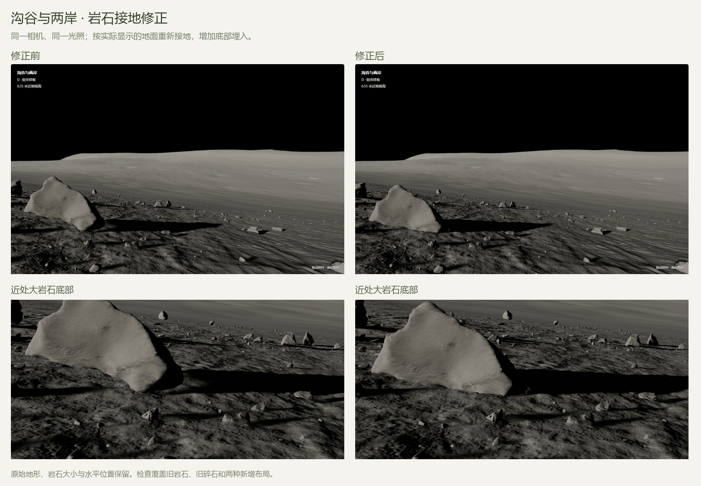
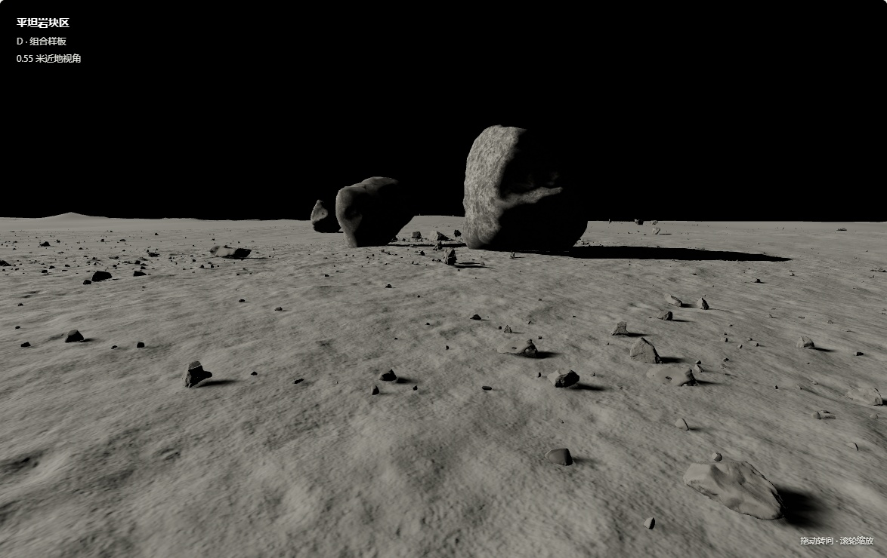
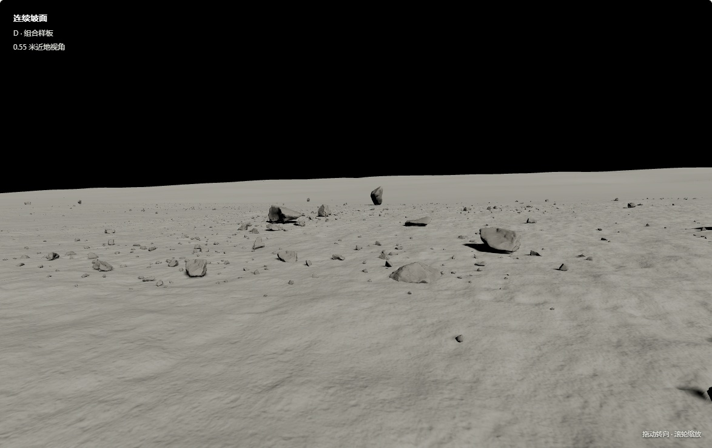
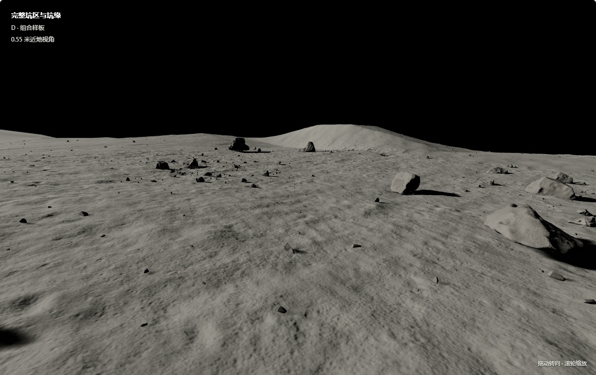
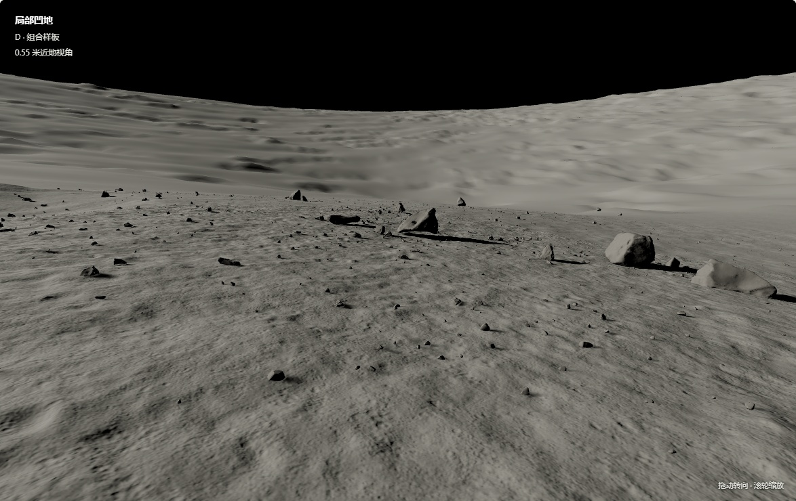
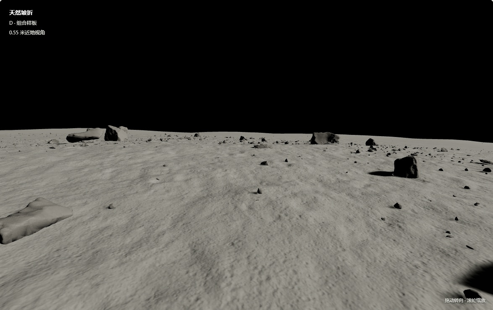
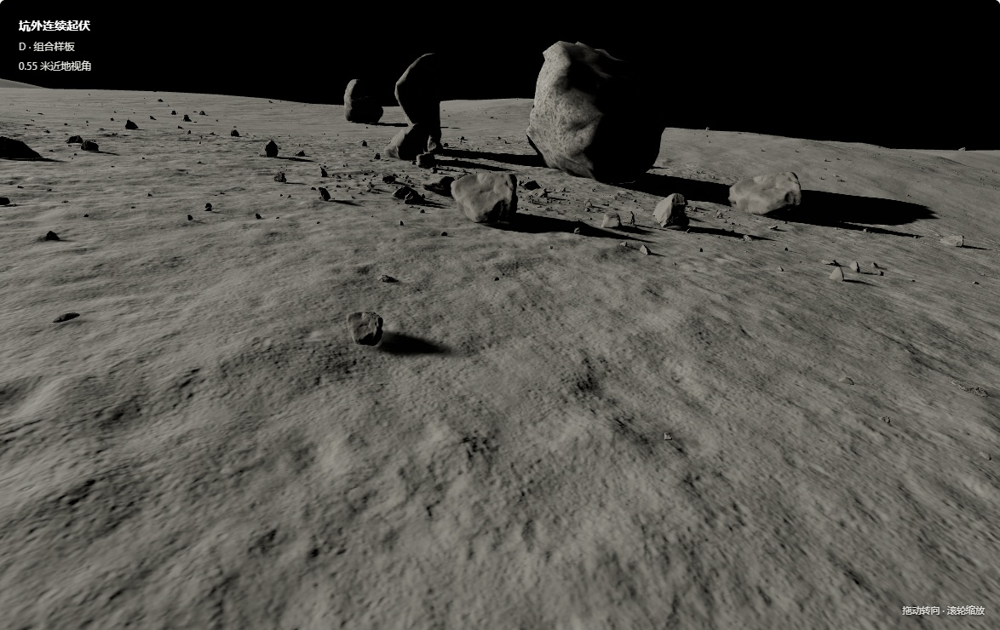
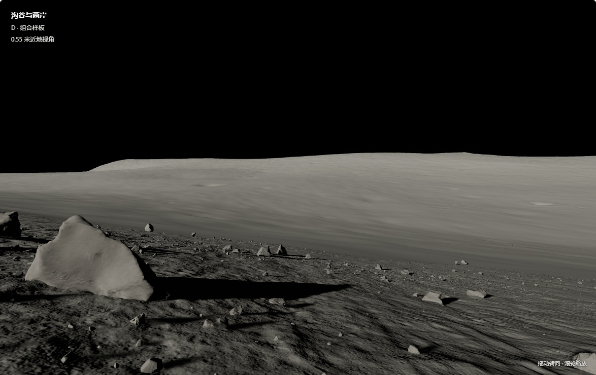

# Moon Terrain · 月面地形与表面细节样板

以真实月面 DEM 为大尺度地形基础，叠加可复现的表面细节和岩石布局，展示七类地形。当前版本是 **Three.js / WebGL 浏览器样板**。



## 下载并查看

**[下载完整离线展示包（约 240 MB）](https://github.com/aichiloo/moon-terrain/releases/download/v0.1.0/Lunar_Detail_Regions_03.zip)**

完整解压后，在 Windows 双击 `START_HERE.cmd`；或用 Edge / Chrome 打开 `START.html`（图片入口）和 `index.html`（三维交互）。完整包可离线使用，不需要安装 Python。请保留所有子目录。

也可以克隆仓库后，用 Python 3.10+ 下载和启动：

```console
git clone https://github.com/aichiloo/moon-terrain.git
cd moon-terrain
python tools/download_demo.py
python tools/verify_demo.py
python tools/serve.py
```

上述下载、校验与浏览工具仅使用 Python 标准库。制作代码的依赖见 `requirements.txt`。

## 七类地形

| 类型 | 组合效果 |
| --- | --- |
| 平坦岩块区 |  |
| 连续坡面 |  |
| 完整坑区与坑缘 |  |
| 局部凹地 |  |
| 天然坡折 |  |
| 坑外连续起伏 |  |
| 沟谷与两岸 |  |

每类只增强一处 12×12 米细节观察点，共七处；不代表原区域的每个位置均已加入同等细节。

## 效果由什么组成

- **真实 DEM**：LROC 的 LINNECRATER、SHACKRDGE02、MERSENIUS1，原始间距约 2 米或 3.5 米，决定大尺度地貌。
- **扫描素材**：Poly Haven 月壤模拟材料与地球岩石扫描，以及 Apollo 样品形状资产。素材来源与原位月面测量需区分。
- **合成增强**：数值生成的小凸起、细颗粒法线、岩石尺寸与空间布局、埋入程度。
- **渲染**：Three.js 材质、太阳光、投影、颜色与曝光处理。
- **检查**：数值与接地检查，加上 Playwright 浏览器加载、切换、截图复查。Skill 是工作指引，不是三维渲染器；下载和运行样板不需要安装 Codex skill。

局部网格间距为 2 厘米，**不等于 2 厘米实测精度**。细节未经对应地点的岩石统计标定。没有调用外部图像或三维生成模型来生成该样板。

## 四种对照

| 版本 | 内容 |
| --- | --- |
| A | 原认可地面与石头布局 |
| B | 增加法线受光细节，几何保持不变 |
| C | 增加真实网格凸起 |
| D | 凸起、法线细节与分层岩石布局组合 |

## 验证范围

- 已检查七类地形、28 种版本切换及 43 张贴图的加载。
- 已检查网格接缝、原始 DEM 副本、导出数据和静态接地；沟谷修订覆盖继承岩石与碎石。
- 已检查完整压缩包、文件哈希及解压后的离线浏览。
- **尚未验证** MuJoCo / UE 导入、动态物理稳定性、机器狗行走、TASK3 重观测或 VLM 导航。

静态接地、截图和页面打开不构成机器人任务成功证据。具体检查记录见 [docs/reports](docs/reports/)。

## 仓库内容与复现边界

```text
src/             数值细节、布局、接地修正与接缝检查代码
viewer/          浏览器页面与渲染代码（大型素材在 Release 中）
tools/           完整样板的下载、文件校验与本地浏览工具
docs/            效果图、参数、来源、历史检查记录
requirements.txt 制作代码所需依赖
```

完整样板的下载、离线查看与文件校验可独立使用。**从原始 DEM 重新构建全部成果仍依赖前序区域库输入；这些输入不在本仓库中。** 本仓库没有声称一条命令可以从原始卫星数据重建全部成果。重建输入格式和处理阶段见 [制作流程](docs/PIPELINE.md)。

第三方资产及其许可见 [THIRD_PARTY_NOTICES.md](THIRD_PARTY_NOTICES.md)。原创代码尚未另行指定开源许可。历史报告保留各自检查阶段的含义，不代表本次上传重新运行了机器人或物理实验。
